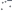

.. _inscribed_angles_same_arc:

inscribed_angles_same_arc
=========================

**inscribed angles same arc** · kind: ``theorem`` · family: ``circle`` · verification: ``verified``

**Euclid:** ``III.21``

.. admonition:: Statement
   :class: note

   In a circle the angles in the same segment are equal to one another.

Canonical Form
--------------

.. code-block:: text

   cyclic(A, B, P, Q) => eq_angle(P, A, P, B, Q, A, Q, B)

Exact Witness Figure
--------------------

   Exact witness verified (4 points, 0 lines, 0 circles)

Base System Realizations
------------------------

.. list-table::
   :header-rows: 1
   :widths: 16 24 60

   * - System
     - Identifier
     - Statement / Form
   * - :doc:`euclid </foundations/cards/euclid>`
     - ``III.21``
     - III.21
   * - :doc:`alphageometry </foundations/cards/alphageometry>`
     - ``rule.r03``
     - cyclic A B P Q => eqangle P A P B Q A Q B
   * - :doc:`newclid </foundations/cards/newclid>`
     - ``R03_ARC_DETERMINES_INTERNAL_ANGLES``
     - cyclic A B P Q => eqangle P A P B Q A Q B, eqangle A Q A P B Q B P, eqangle A B B Q A P P Q, eqangle A B A P Q B Q P

Linked Library Entries
----------------------

Name-matched entries with confidence ≥ 0.7 (lower-confidence token matches are omitted).

.. list-table::
   :header-rows: 1
   :widths: 14 40 12 34

   * - Library
     - Declaration
     - Confidence
     - Evidence
   * - ``mathlib4``
     - `\_root\_.Sbtw.oangle\_sign\_eq\_of\_sbtw <https://github.com/leanprover-community/mathlib4/blob/b97762998b0ee14aea85f37006d06dfff25a6afa/Mathlib/Geometry/Euclidean/Angle/Oriented/Affine.lean#L869>`__
     - 0.7
     - tokens:2
   * - ``mathlib4``
     - `\_root\_.Sbtw.oangle\_sign\_eq\_of\_sbtw\_left <https://github.com/leanprover-community/mathlib4/blob/b97762998b0ee14aea85f37006d06dfff25a6afa/Mathlib/Geometry/Euclidean/Angle/Oriented/Affine.lean#L878>`__
     - 0.7
     - tokens:2
   * - ``mathlib4``
     - `two\_zsmul\_oangle\_iff\_vectorSpan\_eq <https://github.com/leanprover-community/mathlib4/blob/b97762998b0ee14aea85f37006d06dfff25a6afa/Mathlib/Geometry/Euclidean/Angle/Oriented/Affine.lean#L289>`__
     - 0.7
     - tokens:2
