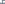

.. _perpendicular_foot:

perpendicular_foot
==================

**perpendicular foot** · kind: ``construction`` · family: ``congruence`` · verification: ``verified``

**Euclid:** ``I.12``

.. admonition:: Statement
   :class: note

   To a given infinite straight line, from a given point which is not on it, to draw a perpendicular straight line.

Canonical Form
--------------

.. code-block:: text

   on_line(c, AB) => on_line(h, AB)

Exact Witness Figure
--------------------

   Exact witness verified (4 points, 2 lines, 0 circles)

Base System Realizations
------------------------

.. list-table::
   :header-rows: 1
   :widths: 16 24 60

   * - System
     - Identifier
     - Statement / Form
   * - :doc:`euclid </foundations/cards/euclid>`
     - ``I.12``
     - I.12
   * - :doc:`leaneuclid </foundations/cards/leaneuclid>`
     - ``Elements.Book1.proposition_12``
     - ∀ (a b c : Point) (AB : Line), distinctPointsOnLine a b AB ∧ ¬(c.onLine AB) → exists h : Point, h.onLine AB ∧ (∠ a:h:c = ∟ ∨ ∠ b:h:c = ∟)
   * - :doc:`alphageometry </foundations/cards/alphageometry>`
     - ``def.foot``
     - foot x a b c

Proof Traces
------------

.. collapse:: LeanEuclid ``Elements.Book1.proposition_12`` (11 steps)

   .. code-block:: lean

      euclid_intros
      euclid_apply (exists_point_opposite AB c) as d
      euclid_apply (circle_from_points c d) as EFG
      euclid_apply (intersections_circle_line EFG AB) as (e, g)
      euclid_apply (proposition_10 e g AB) as h
      euclid_apply (line_from_points c g) as CG
      euclid_apply (line_from_points c h) as CH
      euclid_apply (line_from_points c e) as CE
      use h
      euclid_apply (proposition_8 h c g h c e CH CG AB CH CE AB)
      euclid_finish

Linked Library Entries
----------------------

Name-matched entries with confidence ≥ 0.7 (lower-confidence token matches are omitted).

.. list-table::
   :header-rows: 1
   :widths: 14 40 12 34

   * - Library
     - Declaration
     - Confidence
     - Evidence
   * - ``geocoq``
     - `proposition\_12 <https://github.com/GeoCoq/GeoCoq/blob/87e8f9c3bc9cb2f782b86153bcf8d5bac52d7ef6/theories/Elements/OriginalProofs/proposition_12.v#L7>`__
     - 1.0
     - euclid\_ref:proposition\_12
   * - ``mathlib4``
     - `orthogonalProjection <https://github.com/leanprover-community/mathlib4/blob/b97762998b0ee14aea85f37006d06dfff25a6afa/Mathlib/Geometry/Euclidean/Projection.lean#L42>`__
     - 0.95
     - lexicon:EuclideanGeometry.orthogonalProjection
   * - ``mathlib4``
     - `inner\_vsub\_altitudeFoot\_vsub\_altitudeFoot\_eq\_zero <https://github.com/leanprover-community/mathlib4/blob/b97762998b0ee14aea85f37006d06dfff25a6afa/Mathlib/Geometry/Euclidean/Altitude.lean#L313>`__
     - 0.7
     - tokens:2
