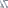

.. _thales_intercept:

thales_intercept
================

**thales intercept** · kind: ``theorem`` · family: ``similarity`` · verification: ``verified``

**Euclid:** ``VI.2``

.. admonition:: Statement
   :class: note

   If a straight line be drawn parallel to one of the sides of a triangle, it will cut the sides of the triangle proportionally; and, if the sides of the triangle be cut proportionally, the line joining the points of section will be parallel to the remaining side of the triangle.

Canonical Form
--------------

.. code-block:: text

   para(A, B, C, D), coll(O, A, C), coll(O, B, D) => eq_ratio(A, B, C, D, O, O)

Exact Witness Figure
--------------------

   Exact witness verified (5 points, 2 lines, 0 circles)

Base System Realizations
------------------------

.. list-table::
   :header-rows: 1
   :widths: 16 24 60

   * - System
     - Identifier
     - Statement / Form
   * - :doc:`euclid </foundations/cards/euclid>`
     - ``VI.2``
     - VI.2
   * - :doc:`alphageometry </foundations/cards/alphageometry>`
     - ``rule.r07``
     - para A B C D, coll O A C, coll O B D => eqratio3 A B C D O O
   * - :doc:`newclid </foundations/cards/newclid>`
     - ``R07_THALES_THEOREM_1``
     - para A B C D, coll O A C, coll O B D, ncoll O A B => simtri O A B O C D, eqratio O A C A O B B D, eqratio O C A C O D B D
