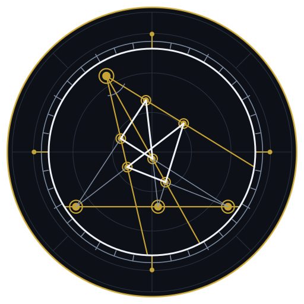

.. container:: author-overline

   semantic digital archive • mathematical catalog

=============================
Geometric Codes & Proportions
=============================

**Why should I believe this is true?** Every geometric system answers that question
differently. Euclid points to the postulates and the reader. LeanEuclid and GeoCoq
point to a proof kernel and a set of geometric axioms. mathlib points to the real
numbers alone. AlphaGeometry points to a rule list and a numeric diagram. A CAS such
as ``geometor.model`` points to an exact figure whose relations reduce to zero.

CODES compares twelve systems by their **truth foundation**: what exists, what is
assumed, how new truths are derived, what evidence is left behind, and what must be
trusted. Exploring the Atlas below is the quickest way in. Click a row to expand a
system, or switch to *Comparison axes*.

.. include:: foundations/_atlas.inc

The Truth Ladder
----------------

The ladder ranks the *strength of the claim* each system certifies. It does not rank
the systems' quality. Dashed edges show routes a system could take to climb.

.. include:: foundations/_ladder.inc

Start here
----------

- :ref:`foundations-index`: the Truth Ladder, the seven-layer Trust Stack, and
  who trusts what.
- :ref:`cards-index`: one card per system, all with the same template.
- :ref:`showcase-index`: five theorems realized side by side, including exact L1
  and generic L2 witnesses from GEOMETOR.
- :ref:`foundations-connections`: lineage and translation bridges, shared
  ontology, and shared principles, drawn as graphs.
- :ref:`catalog-index`: the searchable catalog of 667 discovered principles.
- :ref:`foundations-findings`: the source-audit results behind every card.

.. figure:: /_static/figures/01-seven-ontologies.svg
   :align: center
   :width: 100%

   **One Figure, Eleven Languages**: Euclid's opening *vesica piscis* (:g:`A`, :g:`B`, circles :g:`( A B )` and :g:`( B A )`, equidistant poles :g:`F` and :g:`E` on line :g:`[ A B ]`) viewed simultaneously through diagrammatic :term:`Formal System E`, Tarski's :term:`point-only ontology`, ``mathlib4`` :term:`affine torsor` spaces, ``DD+AR`` clauses, 2D :term:`Conformal Geometric Algebra` null-cone blades, :math:`\mathbb{CP}^2` homogeneous matrices, :person:`Oliver Byrne <byrne>`'s :term:`chromatic value-token` glyphs, and ``geometor.model``'s exact :math:`\mathbb{Q}(\sqrt{3})` DAG. Hover any `:g:` badge or diagram locus to illuminate its corresponding element.

Reference
---------

- :ref:`hierarchy-index`: paradigms of geometric formalization and the GEOMETOR
  architecture.
- :ref:`syntax-index`: a decoder for formal symbols, binders, predicates, blades,
  and Byrne's value-tokens.
- :ref:`systems-index`: long-form dossiers for each system.
- :ref:`rosetta-index`: seven constructions implemented across systems.
- :ref:`opus-index`: the topic × system coverage matrix.
