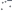

.. _inscribed_angles_same_arc:

inscribed_angles_same_arc
=========================

**inscribed angles same arc** · kind: ``theorem`` · family: ``circle`` · verification: ``verified``

**Euclid:** ``III.21``

.. admonition:: Statement
   :class: note

   In a circle the angles in the same segment are equal to one another.

Canonical Form
--------------

.. code-block:: text

   cyclic(A, B, P, Q) => eq_angle(P, A, P, B, Q, A, Q, B)

Exact Witness Figure
--------------------

   Exact witness verified (4 points, 0 lines, 0 circles)

Base System Realizations
------------------------

.. list-table::
   :header-rows: 1
   :widths: 16 24 60

   * - System
     - Identifier
     - Statement / Form
   * - ``euclid``
     - ``III.21``
     - III.21
   * - ``alphageometry``
     - ``rule.r03``
     - cyclic A B P Q => eqangle P A P B Q A Q B
   * - ``newclid``
     - ``R03_ARC_DETERMINES_INTERNAL_ANGLES``
     - cyclic A B P Q => eqangle P A P B Q A Q B, eqangle A Q A P B Q B P, eqangle A B B Q A P P Q, eqangle A B A P Q B Q P

Linked Library Entries
----------------------

.. list-table::
   :header-rows: 1
   :widths: 14 28 12 46

   * - Library
     - Declaration
     - Confidence
     - Source
   * - ``geocoq``
     - ``Same_dir``
     - 0.35 (tokens:1)
     - `Same_dir <https://github.com/GeoCoq/GeoCoq/blob/87e8f9c3bc9cb2f782b86153bcf8d5bac52d7ef6/theories/Axioms/Definitions.v#L592>`_
   * - ``geocoq``
     - ``alternate_interior_angles_postulate``
     - 0.35 (tokens:1)
     - `alternate_interior_angles_postulate <https://github.com/GeoCoq/GeoCoq/blob/87e8f9c3bc9cb2f782b86153bcf8d5bac52d7ef6/theories/Axioms/parallel_postulates.v#L70>`_
   * - ``geocoq``
     - ``consecutive_interior_angles_postulate``
     - 0.35 (tokens:1)
     - `consecutive_interior_angles_postulate <https://github.com/GeoCoq/GeoCoq/blob/87e8f9c3bc9cb2f782b86153bcf8d5bac52d7ef6/theories/Axioms/parallel_postulates.v#L76>`_
   * - ``mathlib4``
     - ``_root_.Sbtw.oangle_sign_eq_of_sbtw``
     - 0.7 (tokens:2)
     - `_root_.Sbtw.oangle_sign_eq_of_sbtw <https://github.com/leanprover-community/mathlib4/blob/b97762998b0ee14aea85f37006d06dfff25a6afa/Mathlib/Geometry/Euclidean/Angle/Oriented/Affine.lean#L869>`_
   * - ``mathlib4``
     - ``_root_.Sbtw.oangle_sign_eq_of_sbtw_left``
     - 0.7 (tokens:2)
     - `_root_.Sbtw.oangle_sign_eq_of_sbtw_left <https://github.com/leanprover-community/mathlib4/blob/b97762998b0ee14aea85f37006d06dfff25a6afa/Mathlib/Geometry/Euclidean/Angle/Oriented/Affine.lean#L878>`_
   * - ``mathlib4``
     - ``two_zsmul_oangle_iff_vectorSpan_eq``
     - 0.7 (tokens:2)
     - `two_zsmul_oangle_iff_vectorSpan_eq <https://github.com/leanprover-community/mathlib4/blob/b97762998b0ee14aea85f37006d06dfff25a6afa/Mathlib/Geometry/Euclidean/Angle/Oriented/Affine.lean#L289>`_
   * - ``jgex``
     - ``Angles``
     - 0.35 (tokens:1)
     - `Angles <https://github.com/kovzol/Java-Geometry-Expert/blob/5489aacb40afc91b5c5ca539db853cca216e1165/src/main/java/gprover/Angles.java#L8>`_
