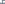

.. _perpendicular_foot:

perpendicular_foot
==================

**perpendicular foot** · kind: ``construction`` · family: ``congruence`` · verification: ``verified``

**Euclid:** ``I.12``

.. admonition:: Statement
   :class: note

   To a given infinite straight line, from a given point which is not on it, to draw a perpendicular straight line.

Canonical Form
--------------

.. code-block:: text

   on_line(c, AB) => on_line(h, AB)

Exact Witness Figure
--------------------

   Exact witness verified (4 points, 2 lines, 0 circles)

Base System Realizations
------------------------

.. list-table::
   :header-rows: 1
   :widths: 16 24 60

   * - System
     - Identifier
     - Statement / Form
   * - ``euclid``
     - ``I.12``
     - I.12
   * - ``leaneuclid``
     - ``Elements.Book1.proposition_12``
     - ∀ (a b c : Point) (AB : Line), distinctPointsOnLine a b AB ∧ ¬(c.onLine AB) → exists h : Point, h.onLine AB ∧ (∠ a:h:c = ∟ ∨ ∠ b:h:c = ∟)
   * - ``alphageometry``
     - ``def.foot``
     - foot x a b c

Proof Traces
------------

.. collapse:: LeanEuclid ``Elements.Book1.proposition_12`` (11 steps)

   .. code-block:: lean

      euclid_intros
      euclid_apply (exists_point_opposite AB c) as d
      euclid_apply (circle_from_points c d) as EFG
      euclid_apply (intersections_circle_line EFG AB) as (e, g)
      euclid_apply (proposition_10 e g AB) as h
      euclid_apply (line_from_points c g) as CG
      euclid_apply (line_from_points c h) as CH
      euclid_apply (line_from_points c e) as CE
      use h
      euclid_apply (proposition_8 h c g h c e CH CG AB CH CE AB)
      euclid_finish

Linked Library Entries
----------------------

.. list-table::
   :header-rows: 1
   :widths: 14 28 12 46

   * - Library
     - Declaration
     - Confidence
     - Source
   * - ``geocoq``
     - ``proposition_12``
     - 1.0 (euclid_ref:proposition_12)
     - `proposition_12 <https://github.com/GeoCoq/GeoCoq/blob/87e8f9c3bc9cb2f782b86153bcf8d5bac52d7ef6/theories/Elements/OriginalProofs/proposition_12.v#L7>`_
   * - ``geocoq``
     - ``perpendicular_transversal_postulate``
     - 0.35 (tokens:1)
     - `perpendicular_transversal_postulate <https://github.com/GeoCoq/GeoCoq/blob/87e8f9c3bc9cb2f782b86153bcf8d5bac52d7ef6/theories/Axioms/parallel_postulates.v#L81>`_
   * - ``geocoq``
     - ``postulate_of_parallelism_of_perpendicular_transversals``
     - 0.35 (tokens:1)
     - `postulate_of_parallelism_of_perpendicular_transversals <https://github.com/GeoCoq/GeoCoq/blob/87e8f9c3bc9cb2f782b86153bcf8d5bac52d7ef6/theories/Axioms/parallel_postulates.v#L87>`_
   * - ``mathlib4``
     - ``orthogonalProjection``
     - 0.95 (lexicon:EuclideanGeometry.orthogonalProjection)
     - `orthogonalProjection <https://github.com/leanprover-community/mathlib4/blob/b97762998b0ee14aea85f37006d06dfff25a6afa/Mathlib/Geometry/Euclidean/Projection.lean#L42>`_
   * - ``mathlib4``
     - ``inner_vsub_altitudeFoot_vsub_altitudeFoot_eq_zero``
     - 0.7 (tokens:2)
     - `inner_vsub_altitudeFoot_vsub_altitudeFoot_eq_zero <https://github.com/leanprover-community/mathlib4/blob/b97762998b0ee14aea85f37006d06dfff25a6afa/Mathlib/Geometry/Euclidean/Altitude.lean#L313>`_
   * - ``mathlib4``
     - ``perpBisector``
     - 0.35 (tokens:1)
     - `perpBisector <https://github.com/leanprover-community/mathlib4/blob/b97762998b0ee14aea85f37006d06dfff25a6afa/Mathlib/Geometry/Euclidean/PerpBisector.lean#L40>`_
   * - ``jgex``
     - ``ge_lt_foot``
     - 0.35 (tokens:1)
     - `ge_lt_foot <https://github.com/kovzol/Java-Geometry-Expert/blob/5489aacb40afc91b5c5ca539db853cca216e1165/src/main/java/gprover/CST.java#L964>`_
   * - ``jgex``
     - ``cal_ax_foot``
     - 0.35 (tokens:1)
     - `cal_ax_foot <https://github.com/kovzol/Java-Geometry-Expert/blob/5489aacb40afc91b5c5ca539db853cca216e1165/src/main/java/gprover/GDDAux.java#L1608>`_
