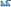

.. _sas_congruence:

sas_congruence
==============

**sas congruence** · kind: ``theorem`` · family: ``congruence`` · verification: ``verified``

**Euclid:** ``I.4``

.. admonition:: Statement
   :class: note

   If two triangles have the two sides equal to two sides respectively, and have the angles contained by the equal straight lines equal, they will also have the base equal to the base, the triangle will be equal to the triangle, and the remaining angles will be equal to the remaining angles respectively, namely those which the equal sides subtend.

Canonical Form
--------------

.. code-block:: text

   cong(a, b, d, e), cong(a, c, d, f), eq_angle(b, a, c, e, d, f), form_triangle(a, b, c, AB, BC, AC), form_triangle(d, e, f, DE, EF, DF) => cong(b, c, e, f), eq_angle(a, b, c, d, e, f), eq_angle(a, c, b, d, f, e)

Exact Witness Figure
--------------------

   Exact witness verified (6 points, 0 lines, 0 circles)

Base System Realizations
------------------------

.. list-table::
   :header-rows: 1
   :widths: 16 24 60

   * - System
     - Identifier
     - Statement / Form
   * - ``euclid``
     - ``I.4``
     - I.4
   * - ``leaneuclid``
     - ``Elements.Book1.proposition_4``
     - ∀ (a b c d e f : Point) (AB BC AC DE EF DF : Line), formTriangle a b c AB BC AC ∧ formTriangle d e f DE EF DF ∧ \|(a─b)\| = \|(d─e)\| ∧ \|(a─c)\| = \|(d─f)\| ∧ (∠ b:a:c = ∠ e:d:f) 
   * - ``newclid``
     - ``R66_SAS_CONGRUENCE_OF_TRIANGLES_DIRECT``
     - cong A B P Q, cong B C Q R, eqangle B A B C Q P Q R, ncoll A B C, sameclock A B C P Q R, diff A B C, diff P Q R => contri A B C P Q R

Proof Traces
------------

.. collapse:: LeanEuclid ``Elements.Book1.proposition_4`` (7 steps)

   .. code-block:: lean

      euclid_intros
      euclid_apply (superposition a b c d e f AB BC AC DE) as (b', c', BC', DC')
      euclid_assert b' = e
      euclid_assert ∠ e:d:c' = ∠ e:d:f
      euclid_assert DC' = DF
      euclid_assert c' = f
      euclid_finish

Linked Library Entries
----------------------

.. list-table::
   :header-rows: 1
   :widths: 14 28 12 46

   * - Library
     - Declaration
     - Confidence
     - Source
   * - ``geocoq``
     - ``decidability_of_congruence_of_points``
     - 0.35 (tokens:1)
     - `decidability_of_congruence_of_points <https://github.com/GeoCoq/GeoCoq/blob/87e8f9c3bc9cb2f782b86153bcf8d5bac52d7ef6/theories/Main/Meta_theory/Decidability/equivalence_between_decidability_properties_of_basic_relations.v#L47>`_
   * - ``geocoq``
     - ``characterization_of_congruence``
     - 0.35 (tokens:1)
     - `characterization_of_congruence <https://github.com/GeoCoq/GeoCoq/blob/87e8f9c3bc9cb2f782b86153bcf8d5bac52d7ef6/theories/Main/Tarski_dev/Ch16_coordinates.v#L696>`_
   * - ``geocoq``
     - ``characterization_of_congruence_F``
     - 0.35 (tokens:1)
     - `characterization_of_congruence_F <https://github.com/GeoCoq/GeoCoq/blob/87e8f9c3bc9cb2f782b86153bcf8d5bac52d7ef6/theories/Main/Tarski_dev/Ch16_coordinates_with_functions.v#L871>`_
