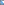

.. role:: raw-html(raw)
   :format: html

.. _showcase-pythagorean:

I.47 · Pythagorean theorem
==========================

.. admonition:: Statement
   :class: note

   In a right triangle the square on the hypotenuse equals the sum of the squares on the legs.

**Why this theorem:** Splits the field: area/analytic methods find it trivial, Euclid needs the Bride's Chair, and the AlphaGeometry rule calculus cannot even state a² + b² = c².

.. graphviz::
   :align: center
   :alt: Pythagorean theorem realizations

   digraph showcase_pythagorean {
     graph [rankdir=LR, bgcolor="transparent", fontname="Helvetica", fontcolor="#8a8f98", nodesep=0.25, ranksep=0.45, ranksep=0.8];
     node [fontname="Helvetica", fontsize=11, style="filled,rounded", shape=box, color="#555a62", fontcolor="#1d1f23", penwidth=0.8];
     edge [fontname="Helvetica", fontsize=9, color="#8a8f98", fontcolor="#8a8f98", arrowsize=0.6];
     thm [label="I.47  Pythagorean theorem", shape=ellipse, style=filled, fillcolor="#ffffff", penwidth=1.6];
     r0 [label=<<b>Euclid</b> Elements I.47 <i>prose</i>>, fillcolor="#e8d9b5", URL="../foundations/cards/euclid.html", target="_top", tooltip="The Bride's Chair: an equality of *areas*, not of numbers."];
     thm -> r0 [style=solid];
     r1 [label=<<b>LeanEuclid</b> proposition_47 <i>theorem</i>>, fillcolor="#9fd8a8", URL="../foundations/cards/leaneuclid.html", target="_top", tooltip="Stated metrically (lengths in ℝ); the proof isolates orientation lemmas Euclid left implicit. SMT_VERIF-dependent."];
     thm -> r1 [style=solid];
     r2 [label=<<b>GeoCoq</b> proposition_47 <i>theorem</i>>, fillcolor="#9fd8a8", URL="../foundations/cards/geocoq.html", target="_top", tooltip="Faithful to Euclid: equal *figures* (EF), with area axioms derived from the Euclidean class."];
     thm -> r2 [style=solid];
     r3 [label=<<b>mathlib4</b> EuclideanGeometry.dist_sq_eq_di… <i>theorem</i>>, fillcolor="#9fd8a8", URL="../foundations/cards/mathlib4.html", target="_top", tooltip="An iff, in any real inner-product space; reduces to the vector identity ‖x−y‖² = ‖x‖² + ‖y‖² when ⟪x,y⟫ = 0."];
     thm -> r3 [style=solid];
     r4 [label=<<b>AlphaGeometry</b> — <i>gap</i>>, fillcolor="#f19c9c", URL="../foundations/cards/alphageometry.html", target="_top", tooltip="DD+AR's algebraic reasoning is linear over angle, ratio, and distance tables; a² + b² = c² is not expressible."];
     thm -> r4 [style=dashed];
     r5 [label=<<b>Newclid</b> R57_PYTHAGORAS_THEOREM <i>rule</i>>, fillcolor="#f6b26b", URL="../foundations/cards/newclid.html", target="_top", tooltip="Added as a special rule, then deactivated by default as problematic."];
     thm -> r5 [style=solid];
     r6 [label=<<b>JGEX</b> examples/visual-proofs/pythagor… <i>generic</i>>, fillcolor="#7fd1c7", URL="../foundations/cards/jgex.html", target="_top", tooltip="Algebraic methods (Wu / Gröbner / area) certify it generically; in the area method it is immediate from the Pythagoras difference P_BAC = 0."];
     thm -> r6 [style=solid];
     r7 [label=<<b>geometor.model</b> verify._build_pythagorean <i>witness</i>>, fillcolor="#9cc3f0", URL="../foundations/cards/geometor_model.html", target="_top", tooltip="Exact quadrance identity on the 3-4-5 figure (L1)."];
     thm -> r7 [style=solid];
   }

Realizations
------------

.. container:: codes-tabs

   .. container:: codes-tab status-prose

      .. rubric:: Euclid

      :raw-html:`prose` ``Elements I.47`` — :doc:`Euclid card </foundations/cards/euclid>`

      .. code-block:: text

         In right-angled triangles the square on the side subtending the right angle is equal
         to the squares on the sides containing the right angle.

      The Bride's Chair: an equality of \*areas\*, not of numbers.

      Source: ``euclid/resources/heath/enunciations.json``

   .. container:: codes-tab status-theorem

      .. rubric:: LeanEuclid

      :raw-html:`theorem` ``proposition_47`` — :doc:`LeanEuclid card </foundations/cards/leaneuclid>`

      .. code-block:: lean

         theorem proposition_47 : ∀ (a b c: Point) (AB BC AC : Line),
           formTriangle a b c AB BC AC ∧ (∠ b:a:c : ℝ) = ∟ →
           |(b─c)| * |(b─c)| = |(b─a)| * |(b─a)| + |(a─c)| * |(a─c)| :=

      Stated metrically (lengths in ℝ); the proof isolates orientation lemmas Euclid left implicit. SMT\_VERIF-dependent.

      Source: `Prop47.lean#L16-L18 <https://github.com/loganrjmurphy/LeanEuclid/blob/33a72c0fa83914202532998a2e7b8771295c3cc7/Book/Prop47.lean#L16-L18>`__

   .. container:: codes-tab status-theorem

      .. rubric:: GeoCoq

      :raw-html:`theorem` ``proposition_47`` — :doc:`GeoCoq card </foundations/cards/geocoq>`

      .. code-block:: coq

         Lemma proposition_47 :
            forall A B C D E F G H K,
            Triangle A B C -> Per B A C -> SQ A B F G -> TS G B A C -> SQ A C K H -> TS H C A B -> SQ B C E D -> TS D C B A ->
            exists X Y, PG B X Y D /\ BetS B X C /\ PG X C E Y /\ BetS D Y E /\ EF A B F G B X Y D /\ EF A C K H X C E Y.

      Faithful to Euclid: equal \*figures\* (EF), with area axioms derived from the Euclidean class.

      Source: `proposition\_47.v#L10-L13 <https://github.com/GeoCoq/GeoCoq/blob/87e8f9c3bc9cb2f782b86153bcf8d5bac52d7ef6/theories/Elements/OriginalProofs/proposition_47.v#L10-L13>`__

   .. container:: codes-tab status-theorem

      .. rubric:: mathlib4

      :raw-html:`theorem` ``EuclideanGeometry.dist_sq_eq_dist_sq_add_dist_sq_iff_angle_eq_pi_div_two`` — :doc:`mathlib4 card </foundations/cards/mathlib4>`

      .. code-block:: lean

         theorem dist_sq_eq_dist_sq_add_dist_sq_iff_angle_eq_pi_div_two (p₁ p₂ p₃ : P) :
             dist p₁ p₃ * dist p₁ p₃ = dist p₁ p₂ * dist p₁ p₂ + dist p₃ p₂ * dist p₃ p₂ ↔
               ∠ p₁ p₂ p₃ = π / 2 := by

      An iff, in any real inner-product space; reduces to the vector identity ‖x−y‖² = ‖x‖² + ‖y‖² when ⟪x,y⟫ = 0.

      Source: `RightAngle.lean#L326-L328 <https://github.com/leanprover-community/mathlib4/blob/b97762998b0ee14aea85f37006d06dfff25a6afa/Mathlib/Geometry/Euclidean/Angle/Unoriented/RightAngle.lean#L326-L328>`__

   .. container:: codes-tab status-gap

      .. rubric:: AlphaGeometry

      :raw-html:`gap` — :doc:`AlphaGeometry card </foundations/cards/alphageometry>`

      DD+AR's algebraic reasoning is linear over angle, ratio, and distance tables; a² + b² = c² is not expressible.

   .. container:: codes-tab status-rule

      .. rubric:: Newclid

      :raw-html:`rule` ``R57_PYTHAGORAS_THEOREM`` — :doc:`Newclid card </foundations/cards/newclid>`

      .. code-block:: python

         PythagoreanPremises A B C => PythagoreanConclusions A B C
         # DEACTIVATED_RULES = { R57_PYTHAGORAS_THEOREM }

      Added as a special rule, then deactivated by default as problematic.

      Source: `all\_rules.py <https://github.com/LMCRC/Newclid/blob/ac6550732a950564cf7614d605b5bf1eadd29701/newclid/src/newclid/all_rules.py>`__

   .. container:: codes-tab status-generic

      .. rubric:: JGEX

      :raw-html:`generic` ``examples/visual-proofs/pythagoras.gex`` — :doc:`JGEX card </foundations/cards/jgex>`

      Algebraic methods (Wu / Gröbner / area) certify it generically; in the area method it is immediate from the Pythagoras difference P\_BAC = 0.

      Source: `examples <https://github.com/kovzol/Java-Geometry-Expert/tree/5489aacb40afc91b5c5ca539db853cca216e1165/src/main/resources/docs/examples>`__

   .. container:: codes-tab status-witness

      .. rubric:: geometor.model

      :raw-html:`witness` ``verify._build_pythagorean`` — :doc:`geometor.model card </foundations/cards/geometor_model>`

      .. code-block:: python

         A, B, C = m.set_point(0, 0), m.set_point(3, 0), m.set_point(0, 4)
         m.assert_perpendicular(m.construct_line(A, B), m.construct_line(A, C), by="Given")
         sp.simplify(quadrance(A, B) + quadrance(A, C) - quadrance(B, C)) == 0

      Exact quadrance identity on the 3-4-5 figure (L1).

      Source: ``codes/src/geometor/codes/verify.py``

Climbing the ladder in GEOMETOR
-------------------------------

**L1 — exact instance.** ``geometor.model`` builds one figure with exact coordinates and checks the conclusion by ``zero_test``: *Exact witness verified (3 points, 2 lines, 0 circles)* (status ``verified``). See the :ref:`witness entry <pythagorean>`.

**L2 — generic.** Replace the coordinates by free symbols ``x, y, p, q, t``. The right angle at A is built in: AC is AB rotated by 90 degrees and scaled by t. The conclusion's numerator reduces to **0**, so the theorem holds for every configuration outside the degenerate set:

- (p, q) != (0, 0) (A != B)
- t != 0 (A != C)

Computed at build time by :py:func:`geometor.codes.generic.generic_witness`.
